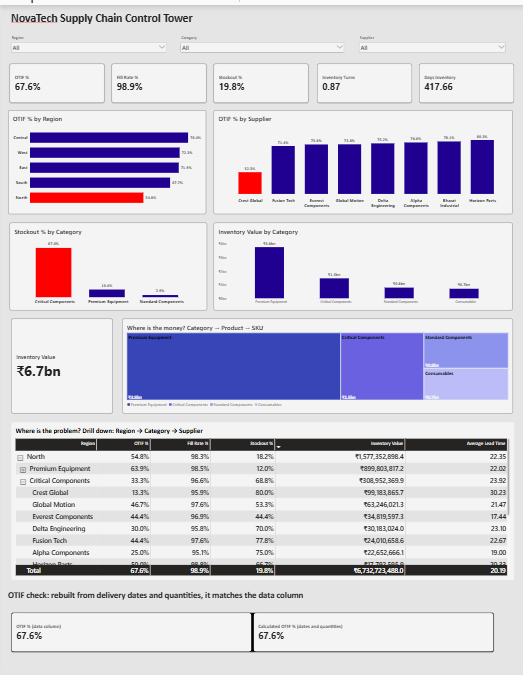

# NovaTech Supply Chain Control Tower (Power BI)

A one-page Power BI dashboard that shows whether NovaTech is serving customers well while controlling inventory, and where the problem is.


## The problem
The COO wants one page, not 50 metrics. Are we serving customers well, are we controlling inventory, where is the problem, and what should management investigate?

## Dashboard


## The 5 KPIs
| KPI | Value | Meaning |
|---|---|---|
| OTIF % | 67.6% | Orders delivered on time and in full |
| Fill Rate % | 98.9% | Units delivered out of units ordered |
| Stockout % | 19.8% | Orders that ran into a stockout |
| Inventory Turns | 0.87 | How many times stock is sold through |
| Days Inventory | 417.66 | 365 divided by Inventory Turns |

## What is on the dashboard
- 3 slicers: Region, Category, Supplier
- 5 KPI cards
- OTIF % by Region, OTIF % by Supplier, Stockout % by Category, Inventory Value by Category
- Inventory Value card and a treemap
- Drill-down matrix: Region, then Category, then Supplier
- OTIF check: the OTIF column in the data compared with OTIF rebuilt from dates and quantities (both 67.6%)

## Answers to the COO
1. **OTIF:** 67.6%.
2. **Region with the biggest problem:** North (54.8% OTIF).
3. **Category needing attention:** Critical Components (67% stockouts).
4. **Supplier to investigate:** Crest Global (32.3% OTIF; all others 71% to 80%).
5. **Where the working capital is:** Premium Equipment, about Rs 3.8bn of Rs 6.7bn.

## Key finding
Fill Rate is 98.9% but OTIF is only 67.6%. Almost everything gets delivered, but a lot of it is late or incomplete. Drilling down, the problem sits in North, Critical Components and Crest Global (North, Critical Components, Crest Global has 13.3% OTIF and 80% stockouts).

## OTIF trap
On time is 81.4% and in full is 81.5%, but only 67.6% of orders are both. OTIF is the overlap of the two conditions.

## Recommended action
Put Crest Global on a supplier recovery plan, starting with Critical Components, and qualify a second supplier. More stock is not the answer: Critical Components already hold Rs 1.5bn and still run out in 67% of orders.

Full write-up: [NovaTech_Final_Report.docx](NovaTech_Final_Report.docx)

## DAX measures used
```DAX
Total Orders = COUNTROWS('Supply_Chain_Data')
OTIF Orders = CALCULATE(COUNTROWS('Supply_Chain_Data'), 'Supply_Chain_Data'[OTIF] = "Yes")
OTIF % = DIVIDE([OTIF Orders], [Total Orders], 0)
Fill Rate % = DIVIDE([Total Delivered Qty], [Total Ordered Qty], 0)
Stockout % = DIVIDE([Stockout Events], [Total Orders], 0)
COGS = SUMX('Supply_Chain_Data', 'Supply_Chain_Data'[Delivered Qty] * 'Supply_Chain_Data'[Unit Cost (INR)])
Inventory Turns = DIVIDE([COGS], [Average Inventory Value], 0)
Days Inventory = DIVIDE(365, [Inventory Turns], 0)
Calculated OTIF % = DIVIDE([Calculated OTIF Orders], [Total Orders], 0)
```

## Files
| File | Purpose |
|---|---|
| NovaTech_Supply_Chain.pbix | Power BI report |
| NovaTech_Supply_Chain_Analytics_Dataset.csv | Source data |
| dashboard.png | Dashboard screenshot |
| NovaTech_Final_Report.docx | Final report |

**Tools:** Power BI Desktop (Power Query, data model, DAX)
